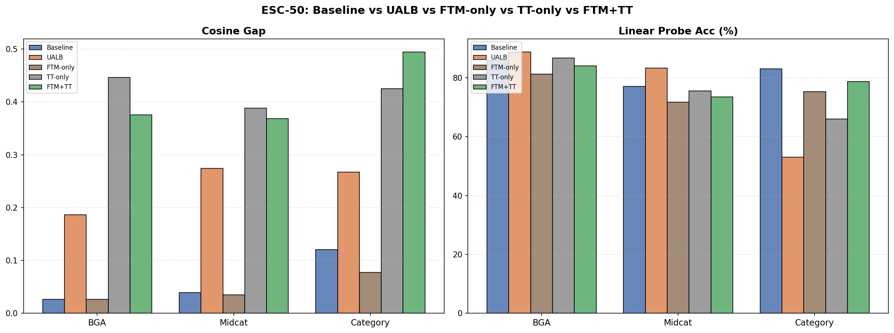

# Hierarchical Acoustic Classification with Pretrained Audio Embeddings

Bachelor thesis project (Uni Oldenburg, advisor: Rida) comparing
multimodal (NatureLM-audio) vs single-modal (BirdNET) pretrained
embeddings for hierarchical (family → genus → species) bioacoustic
classification.

## Status
- ✅ Embedding extraction (NatureLM, BirdNET) — AnuraSet & ESC-50
- ✅ Baseline probing (cosine similarity, t-SNE)
- ✅ Hierarchical training: Tree-Triplet Loss (HSSN), UALB (HiMulCon), ablations (TT-only, FTM-only)
- ✅ Linear probe / NMI evaluation
- ✅ NatureLM vs BirdNET comparison — results generated, analysis in progress
- 🚧 Thesis writing
- ⏳ Additional dataset validation (planned)

## Method
- **Embeddings**: NatureLM-audio (4096-dim, multimodal) vs BirdNET (1024-dim, single-modal)
- **Hierarchy-aware training**:
  - Tree-Triplet Loss ([Li et al., HSSN](https://github.com/lingorX/HieraSeg))
  - UALB / HiMulCon ([Zhang et al.](https://github.com/salesforce/hierarchicalContrastiveLearning))
- **Datasets**: AnuraSet (frog calls, primary), ESC-50 (validation/sanity check)
- **Evaluation**: embedding-space probing (cosine similarity, t-SNE), linear probe + NMI

## Usage

**1. Extract embeddings**
```bash
python scripts/NatureLM/anuraset/baseline/extract_embeddings.py
python scripts/birdnet/anuraset/baseline/extract_embeddings_birdnet.py
```

**2. Baseline probing**
```bash
python scripts/NatureLM/anuraset/baseline/baseline_probing_single.py
```

**3. Train hierarchical models**
```bash
bash scripts/NatureLM/anuraset/tree_triplet/run_train_tree_triplet.sh
bash scripts/NatureLM/anuraset/ualb/run_train_ualb.sh
```

**4. Evaluate**
```bash
python scripts/NatureLM/anuraset/tree_triplet/eval_tree_triplet_abalation.py
python scripts/NatureLM/anuraset/linear_probe_nmi_eval.py
```

(BirdNET 버전은 `scripts/birdnet/...` 경로에 동일 구조로 존재)

Example ablation result (ESC-50, BirdNET embeddings):



## Repository Structure
```
├── data/           # taxonomy & label mappings
├── scripts/        # NatureLM/, birdnet/ — each with anuraset/, esc50/
├── src/            # models, losses (tree-triplet, focal-tree-min, HMLC/UALB), dataset utils
└── results/        # embeddings probing, trained models, evaluation outputs
```

## References
- NatureLM-audio (EarthSpeciesProject)
- BirdNET-Analyzer
- Zhang et al., "Use All The Labels" (CVPR 2022)
- Li et al., "Deep Hierarchical Semantic Segmentation" (HSSN, CVPR 2022)
