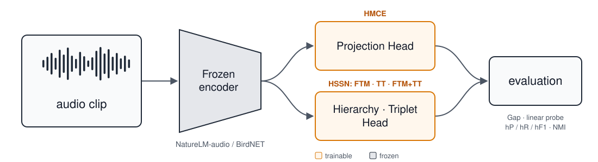

<div align="center">

# Hierarchy-Aware Representation Learning for Bio-acoustic Data

**Keyhyun Ku**<sup>2,3</sup> · **Rida Saghir**<sup>1,2</sup> · **Thiago S. Gouvêa**<sup>1,2</sup> · **Daniel Sonntag**<sup>1,2</sup>

<sup>1</sup> German Research Center for Artificial Intelligence (DFKI), Interactive Machine Learning, Oldenburg<br>
<sup>2</sup> Carl von Ossietzky University of Oldenburg, Applied AI<br>
<sup>3</sup> University of Seoul

**3rd Workshop on Computer Vision for Ecology (CV4E 2026) @ ECCV 2026 · Malmö, Sweden · Poster**

[](https://openreview.net/forum?id=BKu3bEhZzA)
[](https://www.dfki.de/en/web/research/projects-and-publications/publication/17699)
[](#citation)
[](LICENSE)
[](requirements.txt)
[](https://pytorch.org)

</div>

---

> **TL;DR** Hierarchical training objectives from computer vision (HiMulConE, HSSN) are trained as small
> heads on **frozen** bio-acoustic embeddings. In 5 of 6 settings they improve hierarchical F1 over a flat linear probe,
> most clearly in the multi-label setting of passive acoustic monitoring (NatureLM-audio, AnuraSet:
> **50.6 → 85.0 hF1**).

<details>
<summary><b>Abstract</b></summary>

Bio-acoustic data is rich in information and carries meaningful hierarchies that can support different
objectives towards ecological conservation. We take hierarchy-aware training objectives, originally
developed for computer vision applications and transfer them to bioacoustic audio classification. We
adapt four hierarchical learning objectives to audio embeddings from frozen domain-specific and
multimodal audio models, and evaluate them on both a biological taxonomic hierarchy and a soundscape
hierarchy. Across embedding models, hierarchy types, and single- vs. multi-label settings, we find that
imposing hierarchical constraints improves classification even at finest and coarser level. While no
single method wins universally, we observe larger margins in the multi-label PAM setting, and Focal
Tree-Min performs best most often.

</details>

## Overview

Bio-acoustic labels come with hierarchies. A frog call has a species, a genus and a family. A
soundscape clip is biophony, geophony or anthrophony before it is "rain" or "chirping birds". Flat
classifiers ignore this structure, and they discard every sample that has no label at the finest level.

We keep the backbone frozen and change only the **training objective** of a lightweight head:

<p align="center">
  
</p>

| | AnuraSet | ESC-50 |
|---|---|---|
| hierarchy | taxonomic: family (5) → genus (12) → species (42) | soundscape: BGA (3) → mid-category (12) → category (50) |
| data | 93,378 recordings of Neotropical anurans, strongly imbalanced | 2,000 environmental sound clips |
| settings | single-label and multi-label | single-label |

### Objectives

| objective | from | what it imposes |
|---|---|---|
| **HMCE** (HiMulConE) | Zhang et al., CVPR 2022 | supervised contrastive loss at every level; finer levels are weighted higher, and a coarser level's loss can never fall below a finer one's |
| **FTM** (Focal Tree-Min) | Li et al., CVPR 2022 (HSSN) | per-node presence scores that respect the tree: a child never outscores its parent |
| **TT** (Tree-Triplet) | Li et al., CVPR 2022 (HSSN) | triplet margin that grows with tree distance |
| **FTM+TT** | Li et al., CVPR 2022 (HSSN) | both, with TT ramped in over training |

Both original formulations skip same-class pairs at the finest level, which is the classification
target here. We add species-level positives to HMCE and TT (the "implementation gap", paper Sec. 2).

## Results

Hierarchical F1 (hF1, %). The full per-level Gap, accuracy and NMI results are in Tables 2–4 of the paper.

| embedding | setting | frozen baseline | best hierarchical objective |
|---|---|:-:|:-:|
| NatureLM-audio | AnuraSet, single-label | 84.90 | **86.29** (HMCE) |
| | AnuraSet, multi-label | 50.60 | **84.95** (FTM) |
| | ESC-50 | 85.59 | **88.01** (HMCE) |
| BirdNET | AnuraSet, single-label | 81.40 | **81.69** (FTM) |
| | AnuraSet, multi-label | 50.05 | **79.68** (FTM) |
| | ESC-50 | **84.99** | 82.39 (HMCE) |

No single objective wins everywhere. The margins are largest in the multi-label setting, the realistic
one for passive acoustic monitoring. FTM is best most often, and HMCE is best on ESC-50 with NatureLM-audio.

## Installation

```bash
git clone https://github.com/cookiehyun/Hierarchy-Aware_Representation_Learning.git
cd Hierarchy-Aware_Representation_Learning
python -m venv .venv && source .venv/bin/activate
pip install -r requirements.txt
```

Embedding extraction needs the backbone packages in addition (separate environments are
easiest, since BirdNET needs TensorFlow):

- NatureLM-audio: install from [earthspecies/NatureLM-audio](https://github.com/earthspecies/NatureLM-audio) (tested with 1.0.2).
  The weights are loaded from [`EarthSpeciesProject/NatureLM-audio`](https://huggingface.co/EarthSpeciesProject/NatureLM-audio) on Hugging Face.
- BirdNET: `pip install birdnet tensorflow` (tested with birdnet 0.2.16, TensorFlow 2.21)

## Data

Download the datasets and point `HIERBIO_DATA_ROOT` at their parent directory (default `./datasets`):

```text
$HIERBIO_DATA_ROOT/
  anuraset/anuraset/audio/, metadata.csv     AnuraSet (Cañas et al., 2023)
  ESC-50-master/audio/, meta/esc50.csv       ESC-50 (Piczak, 2015)
```

The label hierarchies are included in `data/`:
- `anuraset_taxonomy.csv`: family → genus → species for the 42 AnuraSet species
- `esc50_bga_labels.csv`: BGA → mid-category → category for the 50 ESC-50 classes, made by `scripts/build_esc50_hierarchy.py`

Extract one embedding per clip with each frozen backbone (paper Appendix):

```bash
python scripts/extract_embeddings.py --model naturelm --dataset anuraset
python scripts/extract_embeddings.py --model naturelm --dataset esc50
python scripts/extract_embeddings.py --model birdnet  --dataset anuraset
python scripts/extract_embeddings.py --model birdnet  --dataset esc50
```

The embeddings are written next to the data (`embeddings*/embeddings.npy` + `embeddings_metadata.csv`).

## Reproducing the paper

One run trains a head and evaluates it. It writes `results/runs/<protocol>/<embedding>/<dataset>/<label_mode>[_variant]/<method>/seed<k>/metrics.json`.

```bash
# Table 2: AnuraSet single-label (single-labeled subset)
python scripts/run.py --protocol paper --seed 42 --embedding naturelm --dataset anuraset --label-mode single --method ftm
# Table 3: ESC-50 (folds 1-4 train, fold 5 test)
python scripts/run.py --protocol paper --seed 42 --embedding naturelm --dataset esc50 --method hmce
# Table 4: AnuraSet multi-label, full set including recordings without calls
python scripts/run.py --protocol paper --seed 42 --embedding birdnet --dataset anuraset --label-mode multi --variant unknown --method ftm_tt
```

`--method` is one of `baseline` (frozen embedding + linear probe), `hmce`, `ftm`, `tt`, `ftm_tt`.
To run every cell of Tables 2–4 and print them on a SLURM cluster:

```bash
sbatch slurm/paper_tables.sh
python scripts/aggregate.py --filter paper     # mean ± std tables from metrics.json
```

Each head trains in seconds to a few minutes on one GPU. Retrained heads land within about
±1 point of the published numbers (GPU non-determinism; a few ESC-50 cells move by up to ~2).

**Protocol.** `--protocol paper` is the evaluation behind the published tables:
- validation split with seed 42;
- linear probes on the full training set;
- a fixed multi-label threshold of 0.5;
- Gap computed over all pairs.

The default `--protocol v2` is stricter:
- every random choice follows `--seed`;
- probes are fit on the training part only;
- multi-label thresholds are tuned per class on validation;
- Gap is averaged per class.

## Beyond the paper

These options are in the code but **not** in the paper:

- `flat_linear`, `flat_mlp`, `mlbce`, `focal_mlbce` are flat controls. They use the same head, optimiser and model selection as the hierarchical objectives; only the loss differs.
- `--variant unseen` is an exploratory open-set test. It holds out the classes in `data/unseen_*_split.json`.
- `--save-model` keeps the trained head, and `--checkpoint` evaluates a saved one.

## Code layout

```text
src/hierbio/
  paths.py       filesystem locations (env: HIERBIO_DATA_ROOT, HIERBIO_RESULTS)
  data.py        load_task(embedding, dataset, label_mode, variant) -> train / test splits
  hierarchy.py   3-level tree: node order, ancestor matrix, tree distance
  losses.py      HMCE, FTM, Tree-Triplet (single- and multi-label)
  models.py      projection / hierarchy heads (paper Table 1)
  train.py       one training loop for every objective
  evaluate.py    Gap, linear probe, hP / hR / hF1, clustering NMI
scripts/
  run.py                    train + evaluate one (task, method, seed)
  aggregate.py              tables over runs
  extract_embeddings.py     NatureLM-audio / BirdNET embeddings
  build_esc50_hierarchy.py  ESC-50 -> BGA hierarchy
  plot_tsne.py              t-SNE before / after training
slurm/                      sbatch wrappers (run.sh, grid.sh, paper_tables.sh)
data/                       label hierarchies and unseen-class splits
```

## Citation

```bibtex
@inproceedings{ku2026hierarchyaware,
  title     = {Hierarchy-Aware Representation Learning for Bio-acoustic Data},
  author    = {Ku, Keyhyun and Saghir, Rida and Gouv{\^e}a, Thiago S. and Sonntag, Daniel},
  booktitle = {Third Workshop on Computer Vision for Ecology (CV4E), ECCV},
  year      = {2026},
  url       = {https://openreview.net/forum?id=BKu3bEhZzA}
}
```

## Acknowledgements

This research is part of the [Computational Sustainability & Technology](https://cst.dfki.de/) project area and the DFKI project [AMENABLE – Accessible AI in Sensor-Based Systems for Environment Monitoring](https://www.dfki.de/en/web/research/projects-and-publications/project/amenable). It has been supported by:
- the Lower Saxony Ministry of Science and Culture (MWK) in the zukunft.niedersachsen program;
- the Federal Ministry of Research, Technology and Space (BMFTR) under grant number 16IW26002 (AMENABLE);
- the Endowed Chair of AAI at the University of Oldenburg.

The loss implementations follow the official code of HiMulConE (Zhang et al., 2022) and HSSN (Li et al., 2022).

## License

The code is released under the [MIT License](LICENSE). The datasets (AnuraSet, ESC-50) and the
pretrained models (NatureLM-audio, BirdNET) are not part of this repository and keep their own
licenses. Note that ESC-50 and the BirdNET model weights are licensed for non-commercial use only.
